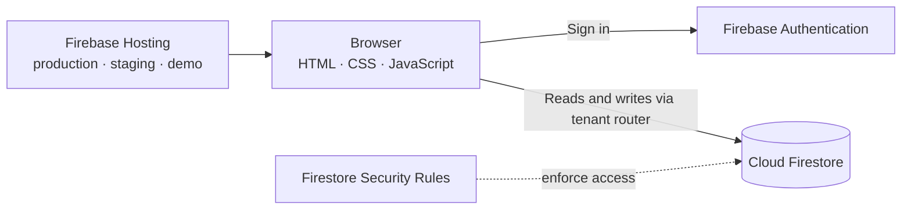

<div align="center">

<h1>Perfexio</h1>
<h3>Goals, Reviews &amp; Growth in one measured system</h3>

**A multi-tenant performance management platform for goals (OKRs), manager reviews, culture and values, and leadership reporting.**


</div>

<br>

## ✨ Overview

Perfexio lets a company run a full review cycle end to end. Employees set weighted objectives, managers assess and sign off, culture and values are scored against the company's own statements, and everyone sees a single weighted score they can trust. Leadership gets reports and dashboards for the whole organisation.

It is a **static web app**: plain HTML, CSS, and JavaScript talking directly to Firebase from the browser. There is no server, no framework, no bundler, and no Cloud Functions, so it loads fast and costs almost nothing to run.

<div align="center">

<a href="https://staging-perfexio-demo.web.app/"></a>

</div>

<br>

## 🎯 How the Score Works

Every person receives one weighted performance score out of 5.0.

| Dimension | Weight | Who scores it |
|---|---:|---|
| 🎯 **Goals** | 50% | Objective progress against target, weighted per objective |
| 👔 **Manager review** | 40% | Manager rating (1 to 5) and sign-off |
| 🌱 **Culture & values** | 10% | Manager ratings against the company's value statements |

Objective weights must add up to exactly **100%** before a cycle can be signed off.

<br>

## 🚀 Features

**For employees**
- Create objectives with key results, targets, success direction (higher or lower is better), and data types such as percentage, number, currency, days, and ratio
- Track progress with update history
- See a final performance summary once the cycle is published

**For managers**
- Review direct reports first, then deeper reporting layers
- Approve goals, rate culture and values, and give qualitative feedback
- Final sign-off with an overall rating and a recommendation: increment, increment and promotion, or no increment

**For admins and leadership**
- Configure review cycles (yearly, half-yearly, quarterly, monthly) with deadlines for goal creation, approval, review, and sign-off
- Import people from a CSV template, manage the roster, and set company branding and culture statements
- Reports with CSV export, including a user performance summary, a detailed goal matrix, and a leadership summary with at-risk goals
- A visual dashboard: goal achievement distribution, performance by department and team, manager rating calibration, goal health, review completion, and goal plan approval
- Publish and lock a cycle, or reopen a signed-off review to correct it
- An in-app product feedback form with its own dashboard

**For the platform team**
- Provision and manage client companies, each with its own workspace, seat plan, and optional allowed email domains

<br>

## 🏗️ Architecture



**Multi-tenancy.** Every client company is a separate workspace inside one Firestore database. All data lives under an environment-based root, and the root is chosen at runtime from the site's hostname:

```
tenants/{production | staging | demo}/companies/{companyId}/...
```

Because every Firestore path goes through a single tenant router, one environment can never read another environment's data, and one company can never see another company's data.

**Security.** The browser is treated as untrusted. Access control is enforced entirely by **Firestore Security Rules**, and the Firebase web configuration is public by design. Records are archived or soft-deleted instead of hard deleted, and the rules deny deletes.

**Three hosting sites, one codebase.** Production, staging, and demo run identical code against different data roots.

<br>

## 🗂️ Project Structure

```
public/
  index.html          single page: auth, onboarding, app screens, modals
  js/
    env.js            environment, brand config, scoring weights
    firebase.js       Firebase init and the tenant path router
    state.js          session, caches, role helpers
    ui.js             modals, tabs, toasts, CSV, image resize
    auth.js           sign-in, tenant resolution, onboarding
    cycles.js         review cycles and role permissions
    okrs.js           objectives, key results, weighting, scoring
    team.js           manager review, values scoring, sign-off
    admin.js          roster, invitations, CSV import, branding
    reports.js        reports, analytics charts, CSV export
    feedback.js       product feedback capture and dashboard
    demo.js           demo sign-in panel and sample data
    app.js            boot sequence (loaded last)
firestore.rules       security rules
firebase.json         hosting targets and rules wiring
tools/test.js         dependency-free test harness
```

<br>

## 🧪 Quality

A custom Node.js test harness replaces the compiler in a project with no build step. Run it with:

```bash
npm test
```

It checks JavaScript syntax, script load order, that every handler referenced in the HTML exists, that element ids used by the code exist in the page, and that UI text is clean English.

<br>

## ⚙️ Getting Started

**Requirements:** Node.js 18 or newer and the [Firebase CLI](https://firebase.google.com/docs/cli).

```bash
# 1. Clone
git clone https://github.com/mprantikk/perfexio-saas.git
cd perfexio-saas

# 2. Install the Firebase CLI and sign in
npm install -g firebase-tools
firebase login

# 3. Point the app at your own Firebase project
#    Create a project, enable Email/Password and Google sign-in,
#    add a Web App, then paste its config into public/js/env.js
firebase use <your-project-id>

# 4. Run the checks
npm test
```

**Deploy order** is always rules, then staging, then demo, then production:

```bash
npm run deploy:rules
npm run deploy:staging
npm run deploy:demo
npm run deploy:production
```

Add your own domains under Authentication → Settings → Authorized domains, and update the hosting targets in `.firebaserc` to match your Firebase sites.

<br>

## 🧰 Tech Stack

| Layer | Technology |
|---|---|
| Frontend | Plain JavaScript (ES6+), HTML, Tailwind CSS |
| Charts | Chart.js |
| Auth | Firebase Authentication (email and password, Google) |
| Database | Cloud Firestore with multi-tenant data model |
| Hosting | Firebase Hosting (multi-site) |
| Testing | Custom Node.js harness |

<br>

## 📄 License

All rights reserved. © Masud Parvej. This repository is shared for viewing and portfolio purposes.

<br>

<div align="center">

**Built by [Masud Parvej](https://mprantikk.github.io/)** · [LinkedIn](https://www.linkedin.com/in/mprantikk) · [mprantikk@gmail.com](mailto:mprantikk@gmail.com)

</div>
